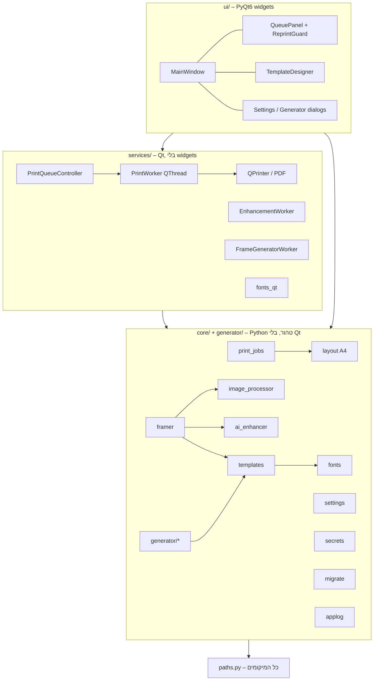

# ארכיטקטורה – MagnetStudio 0.9

מסמך לסוכנים ולמפתחים: מה האפליקציה עושה, איך היא בנויה, ואילו אלגוריתמים יש בה.
מוסכמות קוד ופקודות – ב-[CLAUDE.md](../CLAUDE.md). היסטוריה והחלטות – ב-[JOURNAL.md](JOURNAL.md).

## מה האפליקציה עושה
צלם באירוע (חתונה, בר/בת מצווה) מצלם; התמונות נכנסות לתיקייה (Hot Folder) או נגררות לחלון.
כל תמונה נחתכת לגודל מגנט מדויק ב-300 DPI, משופרת להדפסת Dye-Sub, מולבשת עליה מסגרת (PNG או תבנית
JSON עם שמות הזוג, תאריך וקרדיט צלם), ומודפסת – במדפסת טרמית (מגנט לדף) או כדף A4 עם כמה מגנטים
וקווי חיתוך. הכול עובד **באופליין**; Gemini (מחולל מסגרות, סגנונות ענן) הוא תוספת עם Fallback.

## שכבות



| שכבה | מותר לייבא | אסור |
|------|-----------|------|
| `core/`, `generator/` | Pillow, stdlib, `paths` | **Qt** (נאכף ב-`tests/test_user_data.py`), `services`, `ui` |
| `services/` | Qt Core/Gui/PrintSupport, `core` | `QtWidgets`, `ui` |
| `ui/` | הכול | – |

## זרימת הדפסה
```
תמונה חדשה (Hot Folder / גרירה / "הוסף")
  → PrintQueueController.add_photo()            → כרטיסייה INCOMING
  → print_item() → job_factory(item, copies)   → PrintJob (גודל, מסגרת, מדפסת מהממשק)
  → submit(): מדפסת זמינה? → תור FIFO          → QUEUED (אם ממתין) 
  → PrintWorker (QThread, אחד בכל פעם):
       load_image (EXIF) → fit_to_size → enhancer → מסגרת/תבנית   ENHANCING / COMPOSING
       build_pages (טרמי: דף למגנט · A4: best-fit)                 
       QPainter → QPrinter (או PDF ב-Dry Run)                      SPOOLING
  → succeeded → מונים (+n מגנטים) → persist_settings מיידי         PRINTED
  → failed → הודעת שגיאה, ממשיכים לעבודה הבאה                      FAILED
```

## אלגוריתמים
- **חיתוך לגודל** (`core/image_processor.py`): טעינה עם סיבוב EXIF; אם התמונה אופקית והמגנט אנכי (או
  להפך) – המגנט "מסתובב" לכיוון התמונה (רוחב↔גובה); ואז cover-crop ממורכז (LANCZOS) לגודל המדויק
  בפיקסלים (`core/sizes.py`, ס"מ × 300 / 2.54).
- **פריסת A4** (`core/layout.py › plan_grid`): לכל מגנט שני מועמדים – מקורי ומסובב 90°; לכל אחד
  `cols = ⌊(W − 2·margin + gap) / (w + gap)⌋` (וכן לשורות); בוחרים את המקסימום. 7.5x10 → 6 לדף (2×3 מסובב).
  גריד ממורכז, קווי חיתוך אפורים בהירים מחוץ למגנטים.
- **Fast Enhancer** (`core/ai_enhancer.py`): טבלת LUT של 256 ערכים (הרמת צללים, גמא, קונטרסט –
  מונוטונית) + מטריצת רוויה 3×3 ששומרת על אפור ניטרלי. 24MP < 150ms. ענן Gemini → על כל כשל: LUT מקומי.
- **תבניות** (`core/templates.py`): שכבות לפי z – רקע → גרפיקה z<0 → חלונות תמונה (חורים שקופים) →
  גרפיקה/טקסט z≥0 → קרדיט צלם (תמיד עליון, סיבוב transpose מדויק בלי resampling). זוג אנכי+אופקי
  (`TemplatePair`) נבחר לפי כיוון התמונה אחרי EXIF.
- **טקסט עברי:** libraqm אם קיים ב-Pillow, אחרת python-bidi. ריפוד לפי גבולות הדיו האמיתיים (ניקוד,
  זנבות) והחזרת offset – אחרת אותיות נחתכות.
- **מחולל מסגרות** (`generator/`): `parse` (Regex: סוג אירוע, שמות, תאריך) → `styles`/`presets`
  (דטרמיניסטי, אופליין) או `ai` (Gemini Structured Output לסכמת Pydantic `FrameDesign`) →
  `pipeline.design_to_template` (הידוק לשוליים בטוחים ≥3 מ"מ, ניגודיות ≥4.5:1, טקסט לא על חלון תמונה).
- **הגנת הדפסה חוזרת** (`ui/components/queue_panel.py › ReprintGuard`): רווח על תמונה שהודפסה
  "חומש" את הכרטיסייה ל-1.5 ש' (הבהוב ענבר); רווח שני בחלון הזמן = הדפסה. חצים/Esc מבטלים;
  רווח מוחזק (auto-repeat) לא נחשב; הבקר מסרב לשלוח שוב תמונה שכבר בתור (`allow_duplicate=False`).
- **Hot Folder** (`core/watcher.py`): watchdog `on_created` → המתנה עד שגודל הקובץ יציב (המצלמה/העתקה
  סיימה לכתוב) → callback דרך signal ל-GUI thread.
- **הגדרות** (`core/settings.py`): כתיבה אטומית (temp → fsync → `os.replace`); קובץ פגום → שינוי שם
  ל-`.corrupt-<time>` וברירות מחדל; `save_settings` לא זורק.

## מיקומי קבצים (`magnetstudio/paths.py`)
| מה | Windows | macOS |
|----|---------|-------|
| הגדרות | `%LOCALAPPDATA%\MagnetStudio\settings.json` | `~/Library/Application Support/MagnetStudio/settings.json` |
| תבניות/גופנים של המשתמש | `…\MagnetStudio\data\templates`, `…\data\fonts` | `…/MagnetStudio/data/…` |
| לוג | `%LOCALAPPDATA%\MagnetStudio\Logs` | `~/Library/Logs/MagnetStudio` |
| קבצי הדפסה / PDF | `Documents\MagnetStudio\output` | `~/Documents/MagnetStudio/output` |
| מפתח Gemini | Credential Manager | Keychain |

משאבים מצורפים (`magnetstudio/assets/`) – לקריאה בלבד. `MAGNETSTUDIO_HOME` מעביר את כל נתוני המשתמש
לתיקייה אחת.

---

## סקירת ארכיטקטורה (24.11.2026)
שאלה: "האם המבנה טוב? סטנדרטי? מקובל?" – התשובה: הבסיס טוב (הפרדת core/ui, QThread לכל עבודה ארוכה,
Fallback אופליין, בדיקות), אבל 6 דברים היו מסכנים באירוע אמיתי או חוסמים התקנה:

| # | בעיה | למה זה חשוב | פתרון | סטטוס |
|---|------|-------------|-------|-------|
| 1 | המונה וההגדרות נשמרו רק ביציאה | קריסה / כיבוי חשמל = מונה אבוד | שמירה אחרי כל הדפסה, כתיבה אטומית | ✅ |
| 2 | אין לוג; חריגה ב-slot מפילה את האפליקציה | באירוע אין מסוף לראות שגיאות | לוג מתחלף + excepthook + Qt messages | ✅ |
| 3 | מצב התור מפוזר ב-MainWindow (747 שורות) | קשה לבדוק, באגים בין מצבים | `PrintQueueController` + `Stage` | ✅ |
| 4 | הגדרות/תבניות בתוך תיקיית הקוד, מפתח API בטקסט גלוי, Qt בתוך core | התקנה ב-Program Files / .app לא כתיבה; עדכון מוחק נתונים | תיקיות משתמש, keychain, services/, PyInstaller | ✅ |
| 5 | `frame_generator.py` – 1,170 שורות | קשה לשנות סגנון בלי לשבור | חבילה `generator/` (8 מודולים) | ✅ |
| 6 | סקריפטים בלי חבילה; בדיקות `python tests/x.py` | לא סטנדרטי, אין CI | `pyproject.toml`, pytest, `conftest` מבודד | ✅ |
